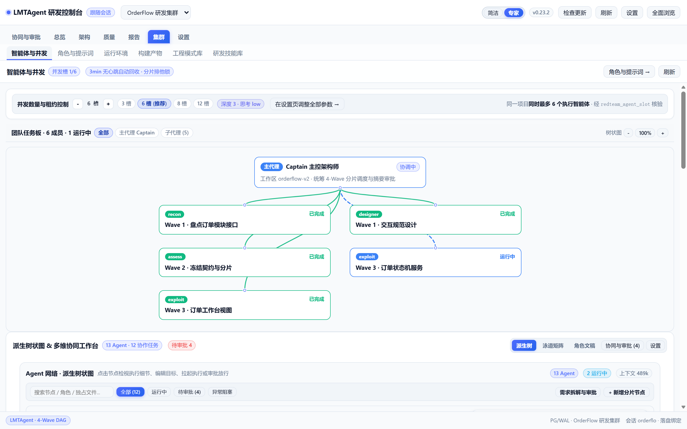
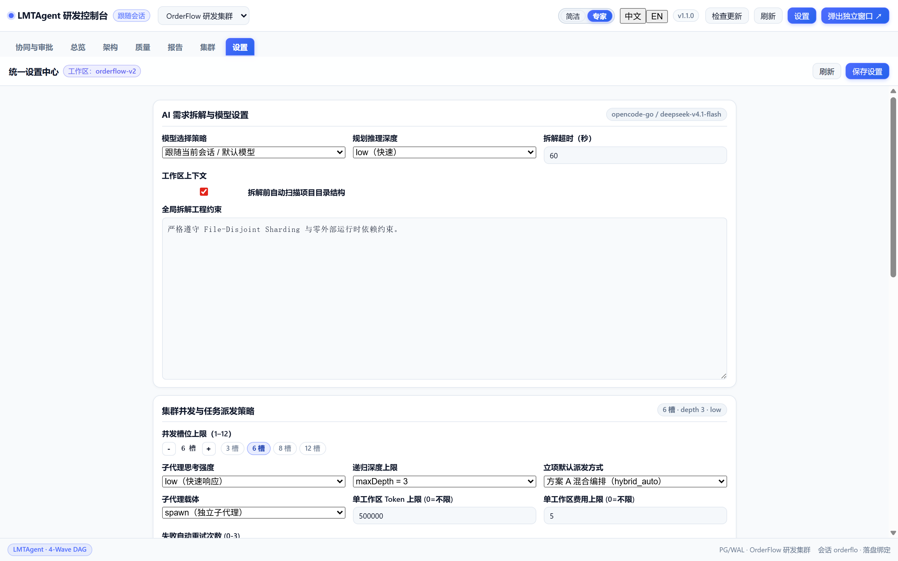

<div align="center">

# ⚡ LMTAgent (`v0.23.2`)

**为 [DeepSeek Harness (DSH Desktop)](https://github.com/anywhere-labs/dsh-desktop) 打造的「`lmtex` 闭环编排 × `gstack` 8 角色协同」全栈软件研发集群与工作台**

[](https://github.com/ECCVIK/LMTAgent)
[](#1-核心工作台架构与可视化交互能力概览v0232)
[](#3-8-角色-gstack-虚拟软件研发团队与运行时-shardlock-排他锁)
[](#5-主题自适应-postgresql-实时写表与摘要压缩探针)
[](#7-质量门禁与测试验证)

<p align="center">
  <b>本项目诞生宗旨优化许愿式编程的体验和可控，目的是让即使无编程语言基础也可以通过此项目作为流水线标准开发得到想要的软件，加上此项目，你的提示词不再会因为模型各种幻觉问题自我误导偏离你想要的开发方向，而是规划润色你的提示词，并拆解成目标并派发已经写好对应角色的子代理去开发</b>
</p>

</div>

---

## ✨ 1. 核心工作台架构与可视化交互能力概览（`v0.23.2`）

LMTAgent 专为解决大模型「许愿式编程（Wishful Programming）」中**需求模糊幻觉、跨会话状态串台、上下文膨胀、多代理并发踩踏与黑盒不可控**痛点而生，融合 [Garry Tan `gstack`](https://github.com/garrytan/gstack)、[chumingjun/dsh-harness-one](https://github.com/chumingjun/dsh-harness-one)、n8n 节点编排交互以及 `lmtex` 主从闭环思想。在 `v0.23.x` 中完成了真实 AI 闭环、总览可展开详表与性能瘦身重构：

- **🤖 真实 AI 澄清拆解（含流式截断修复）与 Strategy A 真实派发**：
  - 彻底移除前端硬编码模板芯片（`WISH_STARTER_TEMPLATES`），澄清与拆解统一调用宿主 **`invokeDshLlmJson`（`ctx.get('llm')`）** 实时推理；将蓝图拆解输出上限提升至 `8192` tokens，并内置 `<think>` 剥离、未闭合围栏兼容与末尾截断 JSON 自动抢救修复（`extractJsonFromLlmText`）；
  - 派发与重跑直连 DSH 真实代理生命周期：优先通过 `subagents.startActivation` 激活对应角色子代理，并在需要主会话接力时通过 `rootAgent.followup` 触发实时执行。
- **📊 总览页极简布局与可展开 `p3/p4/p5` 风格详表（`OverviewTab`）**：
  - 彻底移除底部无用的旧版「交付分值 / 渗透四阶段条（`.rt-ov-hero`）」，第 4 张卡升级为真实的 **交付进度**（Wave 分片完成数 + `worker_digests` 摘要数）；
  - **折叠态**保持「4 张紧凑 KPI 概览卡 + 派生树状图画布」，**点击任意 KPI 卡**可在下方展开零依赖 SVG 环形图（`RtMiniDonut`）、分段占比条（`RtStackedBar`）与结构化明细表（沟通与执行、并发集群、上下文与缓存、交付进度）。
- **📐 1:1 Stage 坐标 SVG 派生树连线与高信噪比界面降噪**：
  - 移除易偏移的 `.rt-n8n-diamond-pin` 菱形装饰点、卡片无用 `P0`–`P3` 标签与重复工作区提示条；采用画布缩放无关的 **`svg.rt-tree-edges-svg` + `measureBoxInStage`** 1:1 坐标测量精确连线。
- **⚙️ 统一设置配置中心（`SettingsHubTab` + `settings.section`）与热路径提速**：
  - 新增统一 5 分区设置页并原生挂载至 DSH 宿主设置；存储层 `settings.js` 新增基于 `mtimeMs` 的单次读取缓存，消除配置读取重复磁盘 I/O，同时清理 28 个零引用 CSS 死规则。
- **🧭 1:1 会话强隔离 + `ShardLock` 排他锁 + `3min` 僵尸租约回收 + SSE**：
  - 按 `props.sessionId` 独立建立 1:1 工作台与 `uninitialized / skipped / initialized` 状态机，支持 `ShardLock` 冲突拦截、超时僵尸槽位回收与 `GET /redteam/events` SSE 毫秒级推送。

| **① 独立「协同与审批」卡片页：1:1 会话初始化指引、需求澄清与审批队列** | **② 升级版「集群 -> 智能体与并发」（`p5` 实时拓扑 + 两步透视 + 全宽泳道）** |
| :---: | :---: |
|  |  |
| *未绑定会话独立进入初始化指引（支持 `跳过指引` 与未对话一键重开）+ 对话式分片立项 + `-86%` 压缩摘要审批队列* | *真实 `AgentsTab` 首屏承载自适应并发租约控制、横向派生树、原位编辑/重跑透视抽屉与常驻 `P0 → P3` 3 段式泳道* |
| **③ `ShardLock` 文件排他锁矩阵、会话隔离表与 PG 16 摘要压缩探针** | **④ `lmtex` 闭环交付文稿主从墙与飞书群聊 Webhook 推送** |
|  |  |
| *`session_onboarding` 1:1 强隔离 + `shard_locks` 文件所有权矩阵（`3min` 僵尸锁回收）+ PG 16 实时写表监控* | *基于 `worker_digests` 自动汇编研发交付文稿主从墙，支持 `feishuConfig` 在线配置与真实飞书群聊卡片推送回执* |

---

## 🔄 2. `lmtex` 闭环调用结构：Step 0 许愿润色、`1 Plan + N Workers` 拆解、压缩与审批

借鉴 `lmtex` 成熟的主从闭环调度范式，LMTAgent 在底层存储引擎（`plan_goals` / `worker_tasks` / `worker_digests` / `shard_locks`）、工具契约（`redteam_workflow`）与前端工作台中贯通标准五步流水线：

```text
[用户输入原始口语许愿 (Raw Wish)]
        │
        ▼  Step 0 · 许愿润色与目标拆解向导 (WishRefinerWizard / refineAndDecomposeWish)
┌──────────────────────────────────────────────────────────────────────┐
│ 消除模糊歧义与模型幻觉 ──► 产出结构化验收契约与阶段目标 (plan_goals) │
└──────────────────────────────────────────────────────────────────────┘
        │
        ▼  Step 1 · 运行时 ShardLock 排他锁分配与并发槽租约登记 (120s TTL)
┌──────────────────────────────────────────────────────────────────────┐
│ Level 0 · 主控 Plan 编排器                                           │
│ 锁定无交集文件分片 (shard_locks)，拦截路径重叠，保障并行写盘零冲突   │
└──────────────────────────────────────────────────────────────────────┘
        │
        ▼  Step 2 · 多 Worker 并发拆解与 DSH 真实代理派发 (subagents.startActivation + rootAgent.followup)
┌───────────────┬───────────────┬───────────────┬──────────────────────┐
│ Worker #1     │ Worker #2     │ Worker #3     │ Worker #N            │
│ recon / CEO   │ designer / UI │ assess / Arch │ exploit / Builder    │
└───────┬───────┴───────┬───────┴───────┬───────┴──────────┬───────────┘
        │               │               │                  │
        ▼  Step 3 · Worker 执行摘要压缩写回 (action: "submit_digest")
┌──────────────────────────────────────────────────────────────────────┐
│ 压缩每个执行器做了什么（what_was_done / files_touched / verification）│
│ 将数千 Token 的工具调用过程压缩 ~85%+ 写入 worker_digests 事实表     │
└──────────────────────────────────────────────────────────────────────┘
        │
        ▼  Step 4 · 原位目标微调 / 单分片重跑 / Plan 闭环审批派发新目标
┌──────────────────────────────────────────────────────────────────────┐
│ 支持 ✏️ 编辑目标 (updateWorkerGoal) · 🔄 单点重跑 (retryWorkerTask)  │
│ 或填入 nextGoal 点击「✓ Plan 审批通过并下达新目标」推进下一波次闭环  │
└──────────────────────────────────────────────────────────────────────┘
```

---

## 🧠 3. 8 角色 `gstack` 虚拟软件研发团队与运行时 `ShardLock` 排他锁

除主代理（Captain `plan`）外，**所有专家子代理均挂载 `@deepseek-ai/dsh-tool-subagent`（`maxDepth: 3`）**，遇到局部子问题可自主递归派生轻量级 `Sub-Worker`（工作台实时追踪递归父子深度），默认以 **`thinking: low`** 低延迟高吞吐运行（顶栏支持一键切换 `low / medium / high`）：

| 序号 | 角色 ID | 预设名称 | 对齐 `gstack` 角色与核心技能 | 递归派发与思考策略 | 核心职责与输出契约 |
| :---: | :--- | :--- | :--- | :---: | :--- |
| **⓪** | **`plan`** | `LMTAgent 研发集群` | **Captain / 架构主控与闭环审批** | 4-Wave 闭环 · `maxDepth: 3` | 润色并拆解用户许愿、分配 `ShardLock` 与 Wave 分片、审批压缩摘要并下达 `nextGoal` |
| **①** | **`recon`** | `CEO / 产品与需求规划` | **CEO / 产品与需求规划** (`/office-hours`, `/plan-ceo-review`) | 可递归派发 · 默认 `low` | 盘点需求边界与仓库模块拓扑（`modules`），消除模糊许愿，产出结构化 PRD |
| **②** | **`designer`** | `Designer / 交互与视觉设计` | **Designer / 交互与视觉设计** (`/plan-design-review`, `/design-shotgun`) | 可递归派发 · 默认 `low` | 制定新手/专家双模式视觉令牌、画布连线规范与组件交互契约 |
| **③** | **`assess`** | `Eng Manager / 架构与排期` | **Eng Manager / 架构与排期** (`/plan-eng-review`) | 可递归派发 · 默认 `low` | 冻结接口 Schema，切分并登记 **`shard_locks` 文件排他分片**，从源头杜绝并发写冲突 |
| **④** | **`vuln-scan`** | `Reviewer & CSO / 审查与安全` | **Reviewer & CSO / 审查与安全** (`/review`, `/cso`) | 可递归派发 · 默认 `low` | 静态代码质量审查、并发租约竞态排查与软件应用安全架构审计 |
| **⑤** | **`exploit`** | `Builder / 全栈研发与构建` | **Builder / 全栈研发与构建**（主力并发执行器） | 可递归派发 `Sub-Worker` · 默认 `low` | 在独占 `ShardLock` 分片内高并发编码实现，完成后释放锁并提交 ~85%+ 压缩比 `worker_digest` |
| **⑥** | **`qa`** | `QA Lead / 质量保障与测试` | **QA Lead / 质量保障与测试** (`/qa`, `/benchmark`) | 可递归派发 · 默认 `low` | 运行全量 20 个测试套件回归门禁、模块化产物同步校验与敏感内容零命中检查 |
| **⑦** | **`internal`** | `Doc & Release / 文档与发布` | **Doc & Release / 文档与发布** (`/ship`, `/document-release`) | 可递归派发 · 默认 `low` | 基于 `worker_digests` 自动汇编「闭环交付文稿主从墙」并通过 `feishuConfig` 推送飞书群聊卡片 |

---

## 🔌 4. 全区域控制台入口、`.jsonl` 增量尾读与 SSE 实时事件流

1. **全区域控制台唤起与一键退出全屏**：在 DSH Desktop **左侧栏面板列表（`sidebar.panellist`）**、**会话头部操作栏（`conversation.session.header.actions`）**、**右上角工具栏（`conversation.session.header.utilities`）** 及 **输入框上方状态条（`conversation.input.dock`）** 挂载 `⚡ LMTAgent 控制台` 按钮；全屏浏览模式下支持顶栏 **`✕ 退出全屏 (Esc)`** 按钮与键盘 `Escape` 立即收起。
2. **增量遥测与 `GET /redteam/events` SSE 推送**：宿主侧通过原生 `tokenMeter` 与 `.jsonl` 字节偏移增量尾读实时采集会话 Token 与子代理树，并通过 `GET /redteam/events` SSE 长连接将数据库写表与节点状态变更毫秒级推送至前端。

---

## 🐘 5. 主题自适应 PostgreSQL 实时写表与摘要压缩探针

内置 **`PgWriteActivityProbe`（`packages/redteam-store/lib/pg-engine.js`）**：

- **表级写入 + 排他分片锁 + 闭环压缩多维监控**：实时追踪 `plan_goals`、`worker_tasks`、`worker_digests`、`shard_locks`、`dag_nodes` 等核心表的 `INSERT / UPDATE / UPSERT` 事务流，直观展示 **`摘要压缩率（compression_ratio_pct）`**、**`节省 Token 数`**、**`活跃分片排他锁 TTL`** 与 **`已审批 / 待审批 Worker 计数`**。
- **双模存储底座**：支持通过 `REDTEAM_PG_URL` 直连外部 **PostgreSQL 16（Wire Protocol v3 + Schema 隔离 + `GIN tsvector` 索引）**；未配置外部 PG 时自动运行于 **256MB `mmap` + `WAL` 高并发本地 SQLite 引擎**（零运行时第三方依赖）。

---

## 🚀 6. 安装与使用指南（DSH Desktop & CLI）

### 方式一：在 DSH Desktop 插件市场中一键导入（推荐）

打开 **[DSH Desktop](https://github.com/anywhere-labs/dsh-desktop)** → 进入「插件市场」→ 点击右上角 **「导入插件」**，粘贴以下描述即可自动识别并安装：

> 我想安装 LMTAgent（v0.23.2）全栈软件研发集群与可视化多智能体工作流插件，仓库地址是 https://github.com/ECCVIK/LMTAgent ，主包路径在仓库根目录（或 packages/redteam-bundle），入口补丁配置是 cordis.patch.yml，前端工作台入口是 lib/client.js。它内置了 1:1 会话专属工作台隔离、真实 AI 需求澄清拆解与 Strategy A 主从真实派发（支持 Wave 间自动接力 `autoAdvanceWave` 与写后 `files_touched` 分片越界审计）、可展开总览详表、前后端版本不一致主动提醒、1:1 Stage 坐标 SVG 派生树连线、统一 5 分区设置配置中心、运行时 ShardLock 文件排他锁、8 位 gstack 软件研发角色以及 GET /redteam/events SSE 实时流，请帮我直接安装并启用该插件。

### 方式二：通过命令行安装

```bash
dsh plugin add github:ECCVIK/LMTAgent
```

---

## 🧪 7. 质量门禁与测试验证

```bash
# 模块化组装前端样式与客户端、构建单包产物并自动同步仓库根目录 lib/
npm run build
node packages/redteam-bundle/tools/build.mjs --check

# 敏感内容闸门自检与全仓扫描（确保 0 命中）
node scripts/check-no-confidential.mjs --all

# 运行全量 22 个零依赖测试套件（Windows & Linux 双端 22 文件 / 1,193 条断言全绿）
npm test
```

---

## 🪞 8. 诚实自省与演进路线（Resolved in `v0.23.2` & Frontier Roadmap）

我们坚持对每一版真实用户体验与能力边界保持诚实透明——在 `v0.23.x` 中，围绕真实 DSH 调用链路、总览详表重构、JSON 容错与性能瘦身完成了系统级升级：

### ✅ 已在 `v0.23.x` 完成落地的核心演进

1. **真实 DSH LLM 需求拆解与 Strategy A 主从派发（含 Wave 自动接力 & 写后越界审计）**：移除前端写死模板芯片，澄清与拆解通过 `invokeDshLlmJson`（`maxTokens: 8192` + `<think>`/截断修复）生成，派发支持 `autoAdvanceWave` 波次自动接力与 `auditWorkerScopeViolation` 分片越界告警。
2. **宿主桥接模块化拆分与前后端版本守卫**：将 `redteam-ui/lib/index.js` 拆出 `llm-planner.js` 与 `dsh-dispatch.js`；前后端握手校验 `hostVersion !== CLIENT_PLUGIN_VERSION` 时主动提示重启 `DSH NEXT`。
3. **总览页移除旧版渗透四阶段条 + 可展开 `p3/p4/p5` 风格详表**：移除 `.rt-ov-hero`，保留折叠态 4 宫格概览，点击展开环形图、分段占比条与结构化明细表。
4. **1:1 Stage 坐标 SVG 派生树连线、配置缓存优化与双端 22/22 全绿**：以 `svg.rt-tree-edges-svg` + `measureBoxInStage` 精确对齐连线；`settings.js` 新增 `mtimeMs` 缓存；修复 Windows 测试句柄与路径兼容性，实现 Windows 与 Linux 双端 `22` 套件 `1,193` 条断言全部通过。

### 🔭 下一步前沿攻坚方向（`v0.23+` Frontier Milestones）

1. **Cordis 内核级 `fs` 系统调用硬沙箱拦截（Kernel-Level `fs` Pre-Hook Sandbox）**：
   - 当前 `ShardLock` 已在工作流编排与任务锁层拦截越界声明，但若子代理通过原生 `tool-bash` 直接执行底层 shell 重定向写文件，仍需在 Cordis 宿主工具内核层挂载 `fs-write / bash` Pre-Hook 白名单硬拦截。
2. **基于 `pgvector` 的跨波次语义记忆检索（Neural Semantic Digest Retrieval）**：
   - 目前 `worker_digests` 支持结构化压缩与 PostgreSQL `GIN tsvector` 词法全文检索；下一步计划在外部 PG 16 模式下可选启用 `pgvector` 向量嵌入索引，让跨百个分片的长周期项目具备精准语义上下文召回能力。
3. **画布级自由拓扑连线编排（Interactive Edge Re-Wiring & Custom DAG Authoring）**：
   - 在现有原位编辑目标与单分片重跑基础上，进一步支持用户在画布上直接鼠标拖拽端口新建自定义阶段节点、可视化增删依赖边并保存为可复用的团队研发流水线模板。
4. **内部包目录历史命名的平滑兼容迁移**：
   - 为保持已安装用户的 `dsh-redteam-mode` 插件配置与本地 SQLite 历史库 100% 向前兼容，底层 workspace 目录仍保留 `redteam-*` 包名前缀，后续将通过双包别名过渡层平滑演进为统一的 `lmtagent-*` 命名空间。
