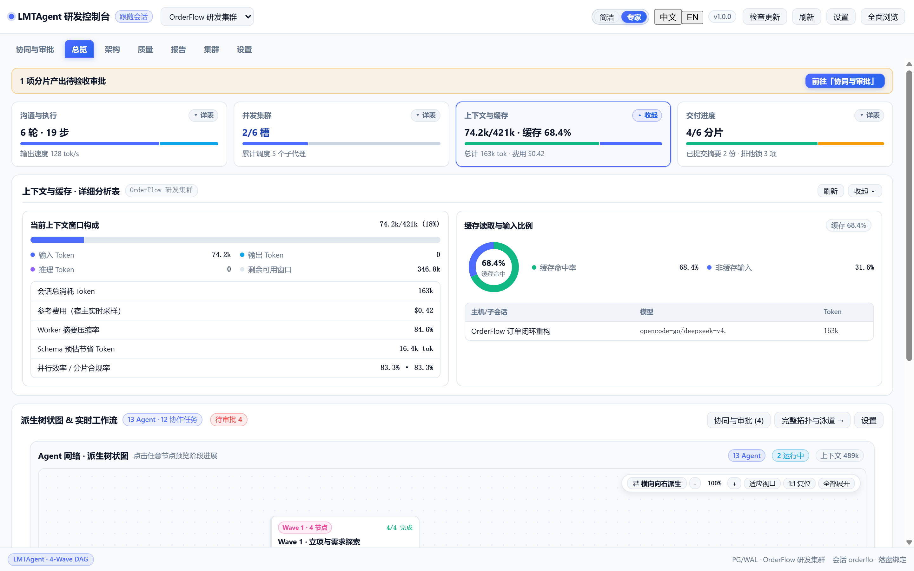

English | [简体中文](README.zh-CN.md)

# LMTAgent (`v0.23.2`)

Multi-agent software engineering orchestrator and docked workbench plugin for DeepSeek Harness (DSH Desktop).

Built around a deterministic 4-Wave DAG engineering pipeline (`Wish Clarification -> File-Disjoint Sharding -> Master-Worker Concurrent Dispatch -> Digest Compression -> Approval & Wave Advance`), LMTAgent prevents requirement drift, cross-session workspace collisions, concurrent write conflicts, and opaque background execution.

## UI Preview (`v0.23.2`)

Captured directly in headless Edge from the compiled `packages/redteam-ui/lib/client.js` and `styles.js` bundles:

| Overview & Expandable Context Table (`Overview`) | Cluster Scheduling & Topology Tree (`Cluster -> Agents & Concurrency`) |
| :---: | :---: |
|  |  |
| **Collaboration & Approval Queue (`Collab & Approval`)** | **Unified Settings Center (`Settings`)** |
|  |  |

---

## 1. Core Capabilities & Architecture

1. **1:1 Session-Isolated Workspaces**
   - Maintains an independent `uninitialized / skipped / initialized` state machine per active DSH session (`props.sessionId` + `$DSH_HOME/redteam/sessions.json`), ensuring new sessions never bind to unrelated projects. Supports skipping onboarding and reopening it anytime before conversation starts.
2. **Real-Time AI Clarification, Sharding & Truncated JSON Repair (`packages/redteam-ui/lib/llm-planner.js`)**
   - `clarifyWishWithAI` and `decomposeWishWithAI` run live inference via `invokeDshLlmJson` (`ctx.get('llm')`) with an `8192`-token output budget, `<think>` block stripping, unclosed fence handling, and automatic repair of truncated trailing JSON (`extractJsonFromLlmText`).
3. **Strategy A Master-Worker Dispatch & Wave Auto-Advance (`packages/redteam-ui/lib/dsh-dispatch.js`)**
   - Spawns Wave 1 workers via `subagents.startActivation`, records real `childId` values in the fact store, and syncs the Captain root agent via `rootAgent.followup`.
   - When `autoAdvanceWave` is enabled in Settings, approving all tasks in the current wave automatically launches the next wave's concurrent workers and notifies the root agent.
4. **Runtime `ShardLock` & Post-Write Scope Audit (`packages/redteam-store/lib/core.js`)**
   - Blocks overlapping `files_owned` declarations within the same wave at dispatch time. When a worker submits a `worker_digest`, `auditWorkerScopeViolation` checks `files_touched` against `files_owned` and surfaces `scope_violations` warnings in the approval queue card.
   - Built-in `3min` heartbeat lease reaper (`reapExpiredAgentLeases`) reclaims stalled worker slots automatically.
5. **Compact Overview & On-Demand Detail Drawers (`05-overview-tab.js`)**
   - Displays 4 concise KPI cards (`Execution`, `Concurrency`, `Context & Cache`, `Delivery`) above the derivation tree canvas; clicking any KPI card expands an inline SVG donut chart (`RtMiniDonut`), stacked ratio bar (`RtStackedBar`), and breakdown table.
6. **Zoom-Invariant 1:1 Stage SVG Derivation Tree (`04-workflow-deck.js`)**
   - Computes node coordinates via `measureBoxInStage` and draws edges in an overlay `svg.rt-tree-edges-svg`, supporting horizontal/vertical layout switching and per-node controls.
7. **Unified Settings Center & Host-Client Version Guard (`06-engineering-tabs.js` / `07-cluster-shell.js`)**
   - Consolidates team concurrency & dispatch policy (`maxAgents`, `maxDepth`, `thinkingEffort`, `autoAdvanceWave`), AI Planner model selection, PostgreSQL connection, Feishu webhook notifications, and workspace bindings into a 5-section settings view mounted into DSH `settings.section`.
   - Automatically alerts the top bar to restart `DSH NEXT` when `CLIENT_PLUGIN_VERSION` differs from backend `hostVersion`.

---

## 2. 4-Wave Closed-Loop Workflow

```text
[User Requirement]
      │
      ▼  Step 1: AI Clarification & Sharding (clarifyWishWithAI / decomposeWishWithAI)
[Structured refined_prompt + 4-Wave File-Disjoint goals]
      │
      ▼  Step 2: ShardLock Check & Strategy A Dispatch (ShardLock + startActivation + rootAgent.followup)
[Wave 1..4 Concurrent Subagents (with optional autoAdvanceWave)]
      │
      ▼  Step 3: Digest Compression & Scope Audit (submit_digest + auditWorkerScopeViolation)
[Compact what_was_done / files_touched / verification -> worker_digests + scope_ok]
      │
      ▼  Step 4: Approval & Progression (planApproveWorker / updateWorkerGoal / retryWorkerTask)
[Human or Captain Approval -> Advance Next Wave -> Final Delivery Report]
```

---

## 3. 8 Role Presets (`maxDepth: 3`, default `thinking: low`)

| # | Role ID | Preset Name | Core Responsibility & Output Contract |
| :---: | :--- | :--- | :--- |
| 0 | `plan` | `LMTAgent Cluster` | Master Coordinator: orchestrates sharding, digest approval, and next-wave dispatch |
| 1 | `recon` | `CEO / Product & Planning` | Audits requirements and repository boundaries; outputs structured specs |
| 2 | `designer` | `Designer / UX & Visual` | Defines layout, visual tokens, and component interaction contracts |
| 3 | `assess` | `Eng Manager / Architecture` | Freezes API schemas and locks exclusive `shard_locks` file slices |
| 4 | `vuln-scan` | `Reviewer & CSO / Security` | Performs static code review, concurrency checks, and security audits |
| 5 | `exploit` | `Builder / Full-Stack Dev` | Implements features strictly within `files_owned` and submits `worker_digest` |
| 6 | `qa` | `QA Lead / Quality & Tests` | Runs full test suites, build parity checks, and confidential scans |
| 7 | `internal` | `Doc & Release / Delivery` | Compiles delivery reports from `worker_digests` and sends Feishu alerts |

---

## 4. Host Slots, Storage & Real-Time Event Stream

- **6 Host Mount Slots**: `shell.overlay`, `main`, `sidebar.panellist`, `conversation.view`, `conversation.session.header.utilities`, and `settings.section`.
- **Incremental Telemetry & SSE**: Byte-offset `.jsonl` tailing plus `GET /redteam/events` SSE streaming for node and fact-store updates.
- **Dual-Mode Storage**: Connects to external PostgreSQL (Wire Protocol v3) when `REDTEAM_PG_URL`, `DSH_PG_URL`, `DATABASE_URL`, or `PGHOST` is set; otherwise uses local SQLite in WAL mode under `$DSH_HOME/redteam` with zero external runtime dependencies. `settings.js` includes an `mtimeMs`-based in-process config cache.

---

## 5. Installation

### CLI

```bash
dsh plugin add github:ECCVIK/LMTAgent
```

### DSH Desktop Plugin Market

Search for `lmtagent` in the DSH Desktop Plugin Market or import `github:ECCVIK/LMTAgent` directly (pre-built `dsh-redteam-mode-<version>.tgz` tarballs are also available on GitHub Releases).

---

## 6. Build, Gates & Tests

```bash
# Assemble client/styles bundles and sync to packages/redteam-bundle & repo root
npm run build
node packages/redteam-bundle/tools/build.mjs --check

# Confidential gate self-test & full repository scan (0 hits)
node scripts/check-no-confidential.mjs --selftest
node scripts/check-no-confidential.mjs --all

# Run all 22 zero-dependency test suites (22 files / 1,193 assertions passing on Windows & Linux)
npm test
```
