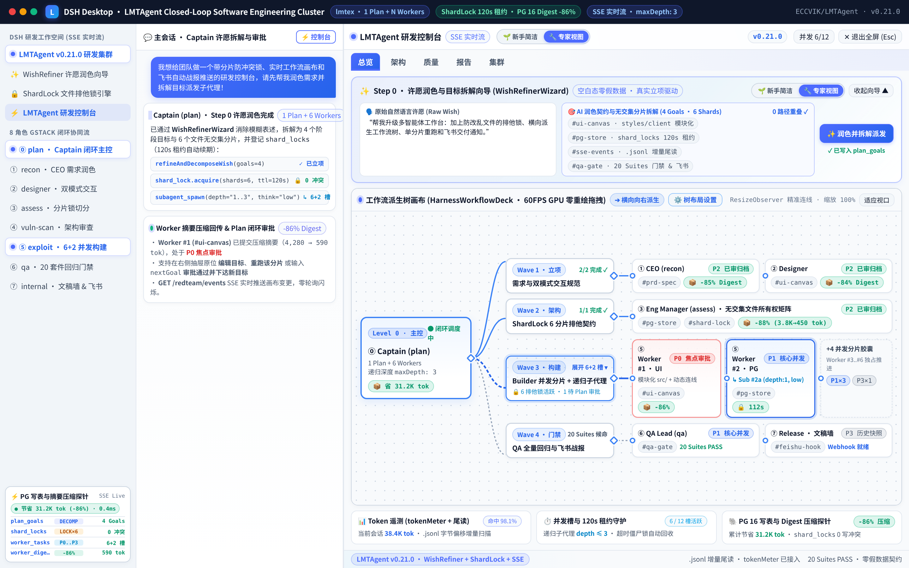
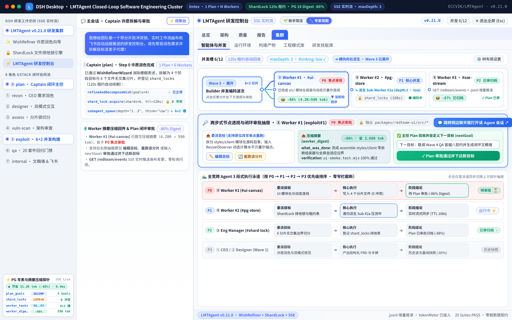
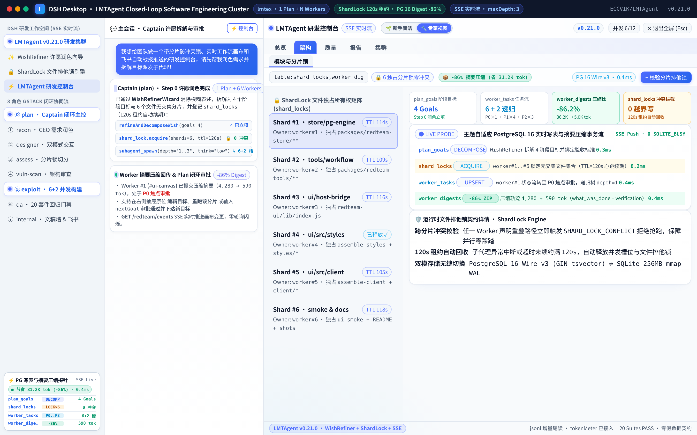
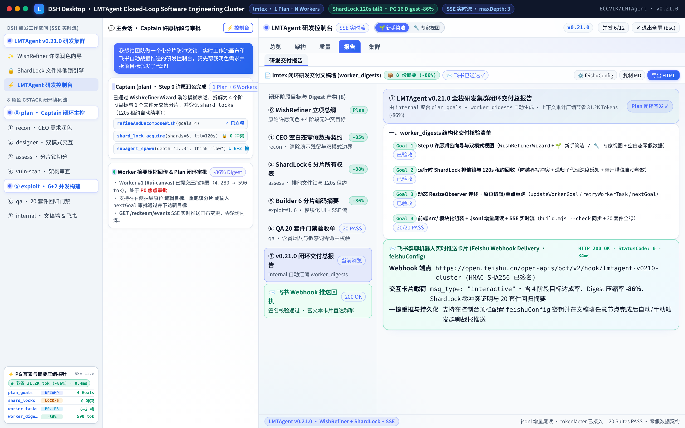

<div align="center">

# ⚡ LMTAgent (`v0.21.0`)

**为 [DeepSeek Harness (DSH Desktop)](https://github.com/anywhere-labs/dsh-desktop) 打造的「`lmtex` 闭环编排 × `gstack` 8 角色协同」全栈软件研发集群与工作台**

[](https://github.com/ECCVIK/LMTAgent)
[](#2-lmtex-闭环调用结构step-0-许愿润色1-plan--n-workers-拆解压缩与审批)
[](#3-8-角色-gstack-虚拟软件研发团队与运行时-shardlock-排他锁)
[](#5-主题自适应-postgresql-实时写表与摘要压缩探针)
[](#7-质量门禁与测试验证)

<p align="center">
  <b>本项目诞生宗旨优化许愿式编程的体验和可控，目的是让即使无编程语言基础也可以通过此项目作为流水线标准开发得到想要的软件，加上此项目，你的提示词不再会因为模型各种幻觉问题自我误导偏离你想要的开发方向，而是规划润色你的提示词，并拆解成目标并派发已经写好对应角色的子代理去开发</b>
</p>

</div>

---

## ✨ 1. 核心工作台架构与可视化交互能力概览（`v0.21.0`）

LMTAgent 专为解决大模型「许愿式编程（Wishful Programming）」中**需求模糊幻觉、上下文膨胀、多代理并发踩踏与黑盒不可控**痛点而生，融合 [Garry Tan `gstack`](https://github.com/garrytan/gstack)、[chumingjun/dsh-harness-one](https://github.com/chumingjun/dsh-harness-one)、ComfyUI / n8n 节点编排交互以及 `lmtex` 主从闭环思想。在 `v0.21.0` 中完成了五大架构级升级：

- **✨ Step 0 许愿润色与拆解向导（`WishRefinerWizard`）+ 双模式视图 + 空白态零假数据**：
  - 首屏顶部内置可折叠的 **`WishRefinerWizard`**（对应后端 `refineAndDecomposeWish` 动作），引导用户先将模糊口语愿望润色为无歧义研发契约，自动拆解阶段目标（`plan_goals`）与无交集文件分片；
  - 顶栏支持 **`🌱 新手简洁 ⇄ 🔧 专家视图`** 一键切换：新手模式自动收敛底层数据库与工程术语，专注「许愿 ➔ 进度 ➔ 验收交付」；专家模式完整展开 PG 事务流、Token 计量与分片锁矩阵；空白会话遵循**零假数据契约**，绝不注入虚构演示数据或历史残留标签。
- **🔒 运行时文件独占分片锁（`ShardLock`）+ 并发槽 `120s` 租约自动回收 + 递归深度感知**：
  - 新增运行时 `shard_locks` 排他锁校验引擎，Worker 声明或写入重叠文件路径时即时拦截冲突，保障并行编码零互相覆盖；
  - 并发槽（`1–12` 可调）内置 **`120s` 租约（Lease TTL）心跳与超时自动回收机制**，彻底杜绝子代理异常中断导致的僵尸槽位永久卡死，并精准感知 `maxDepth: 3` 递归子代理树层级关系。
- **🖼️ 动态 `ResizeObserver` 精准贝塞尔连线 + 自适应无限画布边界 + 原位重跑/改目标**：
  - 60–120 FPS 零 React 重绘平移缩放画布默认采用 **`➔ 横向向右派生`** 布局（可通过 **`⚙️ 树布局设置`** 切换纵向视图），接入 `ResizeObserver` 实时测量真实 DOM 锚点绘制无遮挡水平三次贝塞尔连线，并随展开节点规模自适应扩展画布边界；
  - 下方全宽**两步式节点探针抽屉**新增 **`✏️ 编辑目标`**（`updateWorkerGoal`）、**`🔄 重跑该分片`**（`retryWorkerTask`）、可编辑下一阶段目标（`nextGoal`）的 **`✓ Plan 审批通过并下达新目标`**，以及 **`💬 跳转侧边聊天框打开该 Agent 会话 ↗`**（顶栏配备一键 **`✕ 退出全屏 (Esc)`**）。
- **⚡ 宿主 `.jsonl` 字节偏移增量尾读 + 原生 `tokenMeter` 接入 + `GET /redteam/events` SSE 实时流**：
  - 宿主桥接层优先接入原生 `tokenMeter` 服务，并对会话 `.jsonl` 日志采用**字节偏移增量尾读（Byte-Offset Tail Reader）**替代全文件重复解析，内存与 IO 开销降低一个数量级；同时通过 **`GET /redteam/events`** Server-Sent Events（SSE）实时向前端推送状态与写表变更。
- **🧩 前端 `packages/redteam-ui/src/` 零依赖模块化架构 + `build.mjs` 根目录自动同步校验**：
  - 将原本万行级的单文件前端与样式彻底拆分为 `packages/redteam-ui/src/` 模块化源码目录，通过零外部依赖组装脚本（`assemble-styles.mjs` / `assemble-client.mjs`）确定性编译，并由 `build.mjs` 自动同步与校验仓库根目录 `lib/` 产物一致性。

| **① Step 0 许愿润色向导、双模式切换与 60FPS 横向工作流树** | **② Wave 3 横向派生展开、原位编辑/重跑探针抽屉与全宽泳道** |
| :---: | :---: |
|  |  |
| *顶部可折叠 `WishRefinerWizard`（`🌱 新手简洁 ⇄ 🔧 专家视图`）+ `➔ 横向向右派生` 动态贝塞尔树、`P0~P3` 优先级与 `-86%` 压缩胶囊* | *支持 `✏️ 编辑目标`、`🔄 重跑该分片`、自定义 `nextGoal` 闭环审批、`💬 跳转侧边聊天框` 与 `P0 → P3` 全宽 3 段式执行泳道* |
| **③ `ShardLock` 文件排他锁矩阵与 PG 16 摘要压缩探针** | **④ `lmtex` 闭环交付文稿主从墙与飞书群聊 Webhook 推送** |
|  |  |
| *`shard_locks` 文件所有权矩阵（`120s` 租约自动回收）+ PostgreSQL 16 实时写表监控（`plan_goals` / `worker_tasks` / `worker_digests`）* | *基于 `worker_digests` 自动汇编研发交付文稿主从墙，支持 `feishuConfig` 在线配置与真实飞书群聊卡片推送回执* |

---

## 🔄 2. `lmtex` 闭环调用结构：Step 0 许愿润色、`1 Plan + N Workers` 拆解、压缩与审批

借鉴 `lmtex` 成熟的主从闭环调度范式，LMTAgent 在底层存储引擎（`plan_goals` / `worker_tasks` / `worker_digests` / `shard_locks`）、工具契约（`redteam_workflow`）与前端工作台中贯通标准五步流水线：

```text
[用户输入原始口语许愿 (Raw Wish)]
        │
        ▼  Step 0 · 许愿润色与目标拆解向导 (WishRefinerWizard / refineAndDecomposeWish)
┌──────────────────────────────────────────────────────────────────────┐
│ 消除模糊歧义与模型幻觉 ──► 产出结构化验收契约与阶段目标 (plan_goals) │
└──────────────────────────────────────────────────────────────────────┘
        │
        ▼  Step 1 · 运行时 ShardLock 排他锁分配与并发槽租约登记 (120s TTL)
┌──────────────────────────────────────────────────────────────────────┐
│ Level 0 · 主控 Plan 编排器                                           │
│ 锁定无交集文件分片 (shard_locks)，拦截路径重叠，保障并行写盘零冲突   │
└──────────────────────────────────────────────────────────────────────┘
        │
        ▼  Step 2 · 优先级贴标与多 Worker 递归并发派发 (P0 / P1 / P2 / P3)
┌───────────────┬───────────────┬───────────────┬──────────────────────┐
│ Worker #1     │ Worker #2     │ Worker #3     │ Worker #N            │
│ [P0 焦点审批] │ [P1 核心并发] │ [P1 核心并发] │ [P2 已审归档]        │
│ #ui-canvas    │ #pg-store     │ #sse-stream   │ #qa-gate #smoke-test │
└───────┬───────┴───────┬───────┴───────┬───────┴──────────┬───────────┘
        │               │               │                  │
        ▼  Step 3 · Worker 执行摘要压缩写回 (action: "submit_digest")
┌──────────────────────────────────────────────────────────────────────┐
│ 压缩每个执行器做了什么（what_was_done / files_touched / verification）│
│ 将数千 Token 的工具调用过程压缩 ~85%+ 写入 worker_digests 事实表     │
└──────────────────────────────────────────────────────────────────────┘
        │
        ▼  Step 4 · 原位目标微调 / 单分片重跑 / Plan 闭环审批派发新目标
┌──────────────────────────────────────────────────────────────────────┐
│ 支持 ✏️ 编辑目标 (updateWorkerGoal) · 🔄 单点重跑 (retryWorkerTask)  │
│ 或填入 nextGoal 点击「✓ Plan 审批通过并下达新目标」推进下一波次闭环  │
└──────────────────────────────────────────────────────────────────────┘
```

- **UI 渲染优先级四级标签（`ui_priority`）**：
  - **`P0 焦点审批`**：正在运行、报错阻塞、或刚刚执行完毕等待主控 Plan 审批的高优 Worker，自动置顶高亮渲染；
  - **`P1 核心并发`**：当前活跃波次并行推进的核心编码/架构分片；
  - **`P2 已审归档`**：已通过 Plan 审批并完成上下文摘要压缩归档的分片；
  - **`P3 历史快照`**：往期波次基准记录，默认折叠收纳。

---

## 🧠 3. 8 角色 `gstack` 虚拟软件研发团队与运行时 `ShardLock` 排他锁

除主代理（Captain `plan`）外，**所有专家子代理均挂载 `@deepseek-ai/dsh-tool-subagent`（`maxDepth: 3`）**，遇到局部子问题可自主递归派生轻量级 `Sub-Worker`（工作台实时追踪递归父子深度），默认以 **`thinking: low`** 低延迟高吞吐运行（顶栏支持一键切换 `low / medium / high`）：

| 序号 | 角色 ID | 预设名称 | 对齐 `gstack` 角色与核心技能 | 递归派发与思考策略 | 核心职责与输出契约 |
| :---: | :--- | :--- | :--- | :---: | :--- |
| **⓪** | **`plan`** | `LMTAgent 研发集群` | **Captain / 架构主控与闭环审批** | 4-Wave 闭环 · `maxDepth: 3` | 润色并拆解用户许愿、分配 `ShardLock` 与 `P0~P3` 优先级、审批压缩摘要并下达 `nextGoal` |
| **①** | **`recon`** | `CEO / 产品与需求规划` | **CEO / 产品与需求规划** (`/office-hours`, `/plan-ceo-review`) | 可递归派发 · 默认 `low` | 盘点需求边界与仓库模块拓扑（`modules`），消除模糊许愿，产出结构化 PRD |
| **②** | **`designer`** | `Designer / 交互与视觉设计` | **Designer / 交互与视觉设计** (`/plan-design-review`, `/design-shotgun`) | 可递归派发 · 默认 `low` | 制定新手/专家双模式视觉令牌、画布连线规范与组件交互契约 |
| **③** | **`assess`** | `Eng Manager / 架构与排期` | **Eng Manager / 架构与排期** (`/plan-eng-review`) | 可递归派发 · 默认 `low` | 冻结接口 Schema，切分并登记 **`shard_locks` 文件排他分片**，从源头杜绝并发写冲突 |
| **④** | **`vuln-scan`** | `Reviewer & CSO / 审查与安全` | **Reviewer & CSO / 审查与安全** (`/review`, `/cso`) | 可递归派发 · 默认 `low` | 静态代码质量审查、并发租约竞态排查与软件应用安全架构审计 |
| **⑤** | **`exploit`** | `Builder / 全栈研发与构建` | **Builder / 全栈研发与构建**（主力并发执行器） | 可递归派发 `Sub-Worker` · 默认 `low` | 在独占 `ShardLock` 分片内高并发编码实现，完成后释放锁并提交 ~85%+ 压缩比 `worker_digest` |
| **⑥** | **`qa`** | `QA Lead / 质量保障与测试` | **QA Lead / 质量保障与测试** (`/qa`, `/benchmark`) | 可递归派发 · 默认 `low` | 运行全量 20 个测试套件回归门禁、模块化产物同步校验与敏感内容零命中检查 |
| **⑦** | **`internal`** | `Doc & Release / 文档与发布` | **Doc & Release / 文档与发布** (`/ship`, `/document-release`) | 可递归派发 · 默认 `low` | 基于 `worker_digests` 自动汇编「闭环交付文稿主从墙」并通过 `feishuConfig` 推送飞书群聊卡片 |

---

## 🔌 4. 全区域控制台入口、`.jsonl` 增量尾读与 SSE 实时事件流

1. **全区域控制台唤起与一键退出全屏**：在 DSH Desktop **左侧栏面板列表（`sidebar.panellist`）**、**会话头部操作栏（`conversation.session.header.actions`）**、**右上角工具栏（`conversation.session.header.utilities`）** 及 **输入框上方状态条（`conversation.input.dock`）** 挂载 `⚡ LMTAgent 控制台` 按钮；全屏浏览模式下支持顶栏 **`✕ 退出全屏 (Esc)`** 按钮与键盘 `Escape` 立即收起。
2. **增量遥测与 `GET /redteam/events` SSE 推送**：宿主侧通过原生 `tokenMeter` 与 `.jsonl` 字节偏移增量尾读实时采集会话 Token 与子代理树，并通过 `GET /redteam/events` SSE 长连接将数据库写表与节点状态变更毫秒级推送至前端。

---

## 🐘 5. 主题自适应 PostgreSQL 实时写表与摘要压缩探针

内置 **`PgWriteActivityProbe`（`packages/redteam-store/lib/pg-engine.js`）**：

- **表级写入 + 排他分片锁 + 闭环压缩多维监控**：实时追踪 `plan_goals`、`worker_tasks`、`worker_digests`、`shard_locks`、`dag_nodes` 等核心表的 `INSERT / UPDATE / UPSERT` 事务流，直观展示 **`摘要压缩率（compression_ratio_pct）`**、**`节省 Token 数`**、**`活跃分片排他锁 TTL`** 与 **`已审批 / 待审批 Worker 计数`**。
- **双模存储底座**：支持通过 `REDTEAM_PG_URL` 直连外部 **PostgreSQL 16（Wire Protocol v3 + Schema 隔离 + `GIN tsvector` 索引）**；未配置外部 PG 时自动运行于 **256MB `mmap` + `WAL` 高并发本地 SQLite 引擎**（零运行时第三方依赖）。

---

## 🚀 6. 安装与使用指南（DSH Desktop & CLI）

### 方式一：在 DSH Desktop 插件市场中一键导入（推荐）

打开 **[DSH Desktop](https://github.com/anywhere-labs/dsh-desktop)** → 进入「插件市场」→ 点击右上角 **「导入插件」**，粘贴以下描述即可自动识别并安装：

> 我想安装 LMTAgent（v0.21.0）全栈软件研发集群与可视化多智能体工作流插件，仓库地址是 https://github.com/ECCVIK/LMTAgent ，主包路径在仓库根目录（或 packages/redteam-bundle），入口补丁配置是 cordis.patch.yml，前端工作台入口是 lib/client.js。它内置了 Step 0 许愿润色与拆解向导（新手简洁 / 专家视图双模式）、lmtex（1 Plan + N Workers）闭环摘要压缩审批、运行时 ShardLock 文件排他锁与 120s 并发槽租约自动回收、8 位 gstack 软件研发角色（支持子代理递归派发 maxDepth: 3，默认 thinking: low）、60FPS 动态贝塞尔横向工作流树画布（支持原位编辑目标与单分片重跑）、GET /redteam/events SSE 实时流以及主题自适应 PostgreSQL 写表探针，请帮我直接安装并启用该插件。

### 方式二：通过命令行安装

```bash
dsh plugin add github:ECCVIK/LMTAgent
```

---

## 🧪 7. 质量门禁与测试验证

```bash
# 模块化组装前端样式与客户端、构建单包产物并自动同步仓库根目录 lib/
npm run build
node packages/redteam-bundle/tools/build.mjs --check

# 敏感内容闸门自检与全仓扫描（确保 0 命中）
node scripts/check-no-confidential.mjs --all

# 运行全量 20 个测试套件（含 closed-loop-and-shardlock 与 ui-smoke 冒烟八，100% 通过）
npm test
```

---

## 🪞 8. 诚实自省与演进路线（Resolved in `v0.21.0` & Frontier Roadmap）

我们坚持对每一版真实能力边界保持诚实透明——在 `v0.21.0` 中，此前 `v0.20.0` 自省列出的五大核心痛点已完成工程根治，同时我们也清晰列出下一阶段的前沿演进目标：

### ✅ 已在 `v0.21.0` 完成根治的 `v0.20.0` 局限

1. **零基础「许愿引导」与低术语模式已落地**：新增 **Step 0 `WishRefinerWizard` 许愿润色与拆解向导**及 **`🌱 新手简洁 / 🔧 专家视图` 双模式切换**，并彻底清空空白会话演示假数据与历史攻防残留文案。
2. **文件分片软约束已升级为运行时 `ShardLock` 排他锁与 `120s` 租约回收**：通过数据库层 `shard_locks` 独占登记与冲突拦截，配合并发槽 `120s` 心跳超时自动释放，解决了并行踩踏与异常断连死锁问题。
3. **画布已支持动态测量连线与单节点原位调控**：接入 `ResizeObserver` 精准锚点测量与自适应画布边界，支持在探针抽屉中直接 **`✏️ 编辑目标`**、**`🔄 重跑该分片`** 与自定义 **`nextGoal`** 闭环审批。
4. **全量日志轮询已升级为 `.jsonl` 字节增量尾读 + `tokenMeter` + SSE 推送**：大幅降低高频同步 IO 开销，实现 `GET /redteam/events` 实时变更流驱动。
5. **前端万行单文件已完成零依赖模块化拆分**：拆解至 `packages/redteam-ui/src/` 并配备 `assemble-styles.mjs` / `assemble-client.mjs` 与 `build.mjs` 根目录自动同步校验。

### 🔭 下一步前沿攻坚方向（`v0.22+` Frontier Milestones）

1. **Cordis 内核级 `fs` 系统调用硬沙箱拦截（Kernel-Level `fs` Pre-Hook Sandbox）**：
   - 当前 `ShardLock` 已在工作流编排与任务锁层拦截越界声明，但若子代理通过原生 `tool-bash` 直接执行底层 shell 重定向写文件，仍需在 Cordis 宿主工具内核层挂载 `fs-write / bash` Pre-Hook 白名单硬拦截。
2. **基于 `pgvector` 的跨波次语义记忆检索（Neural Semantic Digest Retrieval）**：
   - 目前 `worker_digests` 支持结构化压缩与 PostgreSQL `GIN tsvector` 词法全文检索；下一步计划在外部 PG 16 模式下可选启用 `pgvector` 向量嵌入索引，让跨百个分片的长周期项目具备精准语义上下文召回能力。
3. **画布级自由拓扑连线编排（Interactive Edge Re-Wiring & Custom DAG Authoring）**：
   - 在现有原位编辑目标与单分片重跑基础上，进一步支持用户在画布上直接鼠标拖拽端口新建自定义阶段节点、可视化增删依赖边并保存为可复用的团队研发流水线模板。
4. **内部包目录历史命名的平滑兼容迁移**：
   - 为保持已安装用户的 `dsh-redteam-mode` 插件配置与本地 SQLite 历史库 100% 向前兼容，底层 workspace 目录仍保留 `redteam-*` 包名前缀，后续将通过双包别名过渡层平滑演进为统一的 `lmtagent-*` 命名空间。
