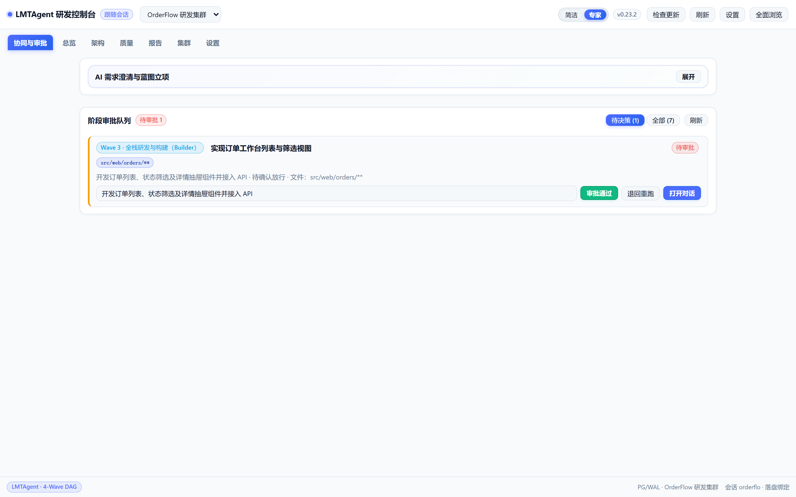

# LMTAgent (`v0.23.2`)

DeepSeek Harness（DSH Desktop）多智能体软件研发编排与工作台插件。

围绕「需求澄清 -> 无交集分片拆解 -> 主从并发派发 -> 摘要压缩 -> 审批推进」建立可控的 4-Wave DAG 工程流水线，解决长程研发中需求跑偏、跨会话串台、并发写盘冲突与黑盒执行问题。

## 界面预览（`v0.23.2`）

以下截图由无头浏览器加载真实编译产物 `packages/redteam-ui/lib/client.js` 与 `styles.js` 直接渲染采集：

| 总览与上下文详表（`总览`） | 集群调度与拓扑树（`集群 -> 智能体与并发`） |
| :---: | :---: |
|  |  |
| **协同与阶段审批队列（`协同与审批`）** | **统一设置中心（`设置`）** |
|  |  |

---

## 1. 核心能力与架构概览

1. **1:1 会话专属工作台隔离**
   - 按当前活跃 DSH 会话（`props.sessionId` + `$DSH_HOME/redteam/sessions.json`）独立建立 `uninitialized / skipped / initialized` 状态机，新会话不会串台绑定旧项目；支持跳过指引与无对话时一键重新打开。
2. **真实 AI 需求澄清、拆解与流式 JSON 修复（`packages/redteam-ui/lib/llm-planner.js`）**
   - 澄清与蓝图拆解通过 `invokeDshLlmJson`（`ctx.get('llm')`）实时推理生成；`decomposeWishWithAI` 输出上限 `8192` tokens，内置 `<think>` 块剥离、未闭合围栏兼容与末尾截断 JSON 自动修复（`extractJsonFromLlmText`）。
3. **Strategy A 主从真实派发与 Wave 间自动接力（`packages/redteam-ui/lib/dsh-dispatch.js`）**
   - 派发时优先经 `subagents.startActivation` 拉起 Wave 1 子代理并将真实 `childId` 写回事实库，同时通过 `rootAgent.followup` 同步主代理 Captain。
   - 在设置中开启 `autoAdvanceWave` 后，当前 Wave 全部任务审批通过时可自动拉起下一 Wave 并发任务并通知主代理。
4. **运行时 `ShardLock` 排他锁与写后越界审计（`packages/redteam-store/lib/core.js`）**
   - 派发阶段拦截同波次重叠 `files_owned` 声明；提交 `worker_digest` 时通过 `auditWorkerScopeViolation` 核对 `files_touched` 是否超出 `files_owned` 边界，并在审批队列卡中给出越界告警（`scope_violations`）。
   - 存储与遥测层内置 `3min` 无心跳僵尸槽位自动回收（`reapExpiredAgentLeases`）。
5. **精简总览与可展开详表（`05-overview-tab.js`）**
   - 默认折叠态展示 4 张核心 KPI 概览卡（沟通与执行、并发集群、上下文与缓存、交付进度）与派生树状图画布；点击任意 KPI 卡可在下方按需展开 SVG 环形图（`RtMiniDonut`）、分段占比条（`RtStackedBar`）与结构化明细表。
6. **1:1 Stage 坐标 SVG 派生树连线（`04-workflow-deck.js`）**
   - 采用与画布缩放无关的 `measureBoxInStage` + 绝对定位 `svg.rt-tree-edges-svg` 绘制节点连线，支持横向/纵向拓扑切换与单节点控制。
7. **统一设置中心与前后端版本一致性守卫（`06-engineering-tabs.js` / `07-cluster-shell.js`）**
   - 将团队并发与派发策略（`maxAgents`、`maxDepth`、`thinkingEffort`、`autoAdvanceWave`）、AI Planner 模型、PostgreSQL 连接、飞书通知与会话工作台管理收口至统一 5 分区设置页，并挂载至 DSH 原生 `settings.section`。
   - 前端 `CLIENT_PLUGIN_VERSION` 与后端透传的 `hostVersion` 不一致时，顶栏自动提示重启 `DSH NEXT`。

---

## 2. 4-Wave 闭环调度流程

```text
[用户输入需求]
      │
      ▼  Step 1: AI 澄清与拆解 (clarifyWishWithAI / decomposeWishWithAI)
[输出结构化 refined_prompt 与 4-Wave File-Disjoint goals]
      │
      ▼  Step 2: 分片锁校验与 Strategy A 派发 (ShardLock + startActivation + rootAgent.followup)
[Wave 1..4 并发子代理执行，支持开启 autoAdvanceWave 波次自动接力]
      │
      ▼  Step 3: 摘要写回与越界审计 (submit_digest + auditWorkerScopeViolation)
[压缩 what_was_done / files_touched / verification 写入 worker_digests，标记 scope_ok]
      │
      ▼  Step 4: 协同审批与推进 (planApproveWorker / updateWorkerGoal / retryWorkerTask)
[人工或主控审批通过 -> 自动或手动推进下一波次 -> 汇编交付报告]
```

---

## 3. 8 个角色预设（`maxDepth: 3`，默认 `thinking: low`）

| 序号 | 角色 ID | 预设名称 | 核心职责与输出契约 |
| :---: | :--- | :--- | :--- |
| 0 | `plan` | `LMTAgent 研发集群` | 主控总指挥：统筹需求拆解、审批压缩摘要与下达下一阶段目标 |
| 1 | `recon` | `CEO / 产品与需求规划` | 盘点需求边界与仓库模块结构，输出结构化需求规格 |
| 2 | `designer` | `Designer / 交互与视觉设计` | 制定界面布局、视觉令牌与组件交互规范 |
| 3 | `assess` | `Eng Manager / 架构与排期` | 冻结接口 Schema，划分并锁定 `shard_locks` 独占文件分片 |
| 4 | `vuln-scan` | `Reviewer & CSO / 审查与安全` | 静态代码审查、并发竞态排查与安全架构审计 |
| 5 | `exploit` | `Builder / 全栈研发与构建` | 在独占 `files_owned` 边界内编码实现并提交 `worker_digest` |
| 6 | `qa` | `QA Lead / 质量保障与测试` | 执行全量测试门禁、构建同步校验与敏感内容扫描 |
| 7 | `internal` | `Doc & Release / 文档与发布` | 基于 `worker_digests` 汇编交付文稿并支持飞书通知推送 |

---

## 4. 宿主挂载槽位、存储与实时事件流

- **宿主挂载槽位（6 处）**：`shell.overlay`、`main`、`sidebar.panellist`、`conversation.view`、`conversation.session.header.utilities`、`settings.section`。
- **增量遥测与 SSE**：通过 `.jsonl` 字节偏移尾读与 `GET /redteam/events` SSE 推送节点及事实库变更。
- **双模存储底座**：配置 `REDTEAM_PG_URL`、`DSH_PG_URL`、`DATABASE_URL` 或 `PGHOST` 时连接外部 PostgreSQL（Wire Protocol v3）；未配置时使用 `$DSH_HOME/redteam` 下的本地 SQLite（WAL 模式，零外部运行时依赖）。`settings.js` 内置基于 `mtimeMs` 的进程内配置缓存。

---

## 5. 安装方式

### 命令行安装

```bash
dsh plugin add github:ECCVIK/LMTAgent
```

### DSH Desktop 插件市场安装

在 DSH Desktop「插件市场」中搜索 `lmtagent` 或通过「导入插件」安装 `github:ECCVIK/LMTAgent`（也可从 GitHub Releases 下载预编译 `dsh-redteam-mode-<version>.tgz`）。

---

## 6. 构建、门禁与测试验证

```bash
# 组装前端样式/客户端并同步至 packages/redteam-bundle 与仓库根目录
npm run build
node packages/redteam-bundle/tools/build.mjs --check

# 敏感内容闸门自检与全仓扫描（0 命中）
node scripts/check-no-confidential.mjs --selftest
node scripts/check-no-confidential.mjs --all

# 运行全部 22 个零依赖测试套件（Windows & Linux 双端 22 文件 / 1,193 条断言通过）
npm test
```
