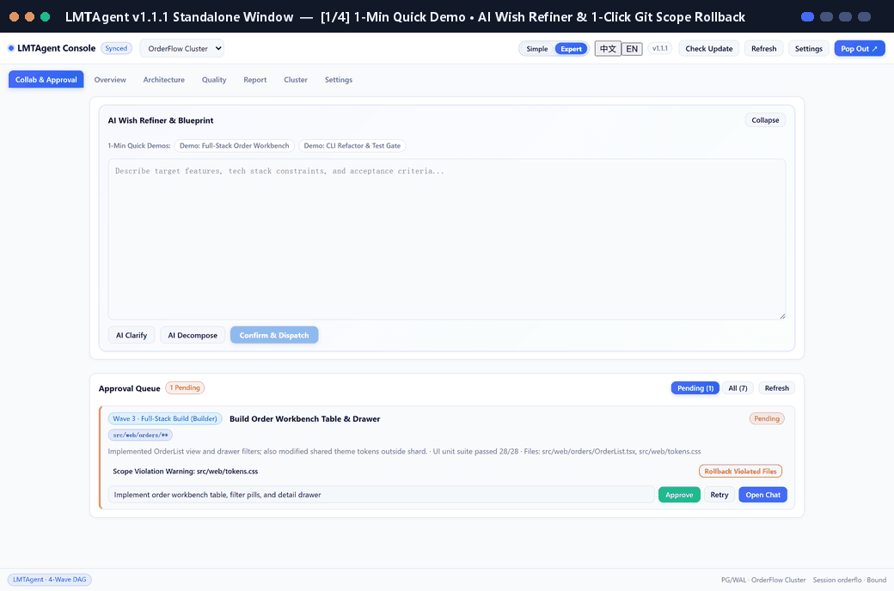
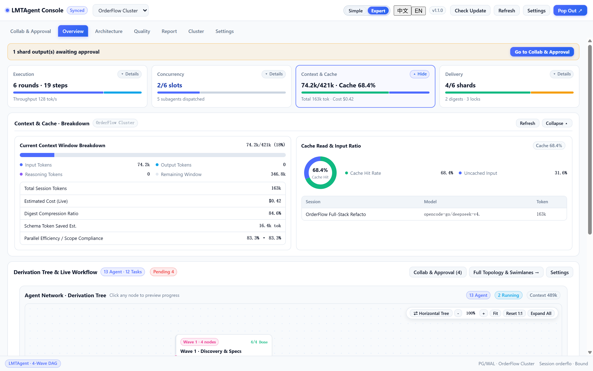
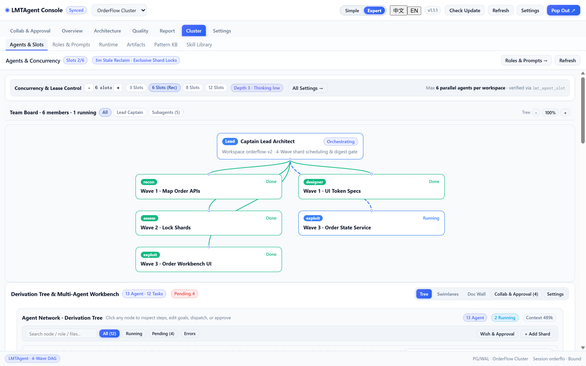
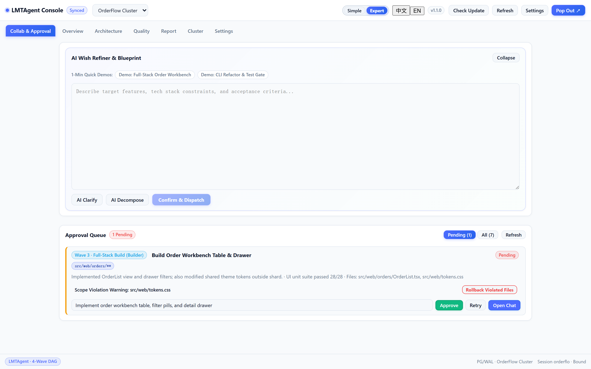
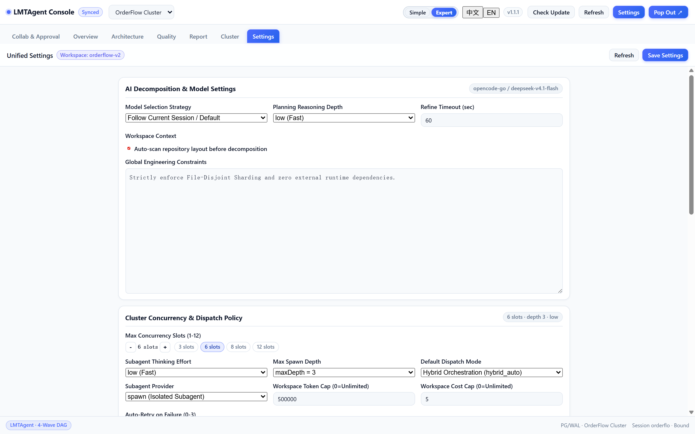

English | [简体中文](README.zh-CN.md)

# LMTAgent (`v1.1.1` · `dsh-lmtagent`)

**Multi-agent full-stack dev workbench for DeepSeek Harness (DSH Desktop)** — turn a one-sentence feature wish into parallel, file-disjoint coding shards, manage approvals in a **true detached OS desktop window (`/lmtagent/window`)**, roll back out-of-scope edits in one click, and cap workspace token/cost budgets automatically.

```bash
dsh plugin add github:ECCVIK/LMTAgent
```



### 1-Minute Quick Start
1. Install via CLI above (or search `dsh-lmtagent` in the DSH Desktop Plugin Market) and restart DSH.
2. Click **`LMTAgent Console`** in the left sidebar or conversation header — a **standalone chromeless desktop window** pops out (draggable to a second monitor, zero cramped right-side drawer blocking your chat).
3. Click either **1-Min Quick Demo** chip (`OrderFlow-Demo` or `CliRefactor-Demo`) in **Collab & Approval** to preview AI wish clarification, 4-Wave sharding, and live DAG scheduling immediately.

---

## Why LMTAgent?

| Common Pain Point with Single-Agent Coding | How LMTAgent Solves It |
| :--- | :--- |
| Vague prompts drift into mock data & half-finished features | **AI Wish Refiner** clarifies requirements & freezes contracts before coding |
| Parallel subagents overwrite each other's files | **`files_owned` ShardLock** pre-write checks + **1-click Git Scope Rollback** |
| Runaway background loops burn through tokens silently | **Workspace Token & Cost Circuit Breaker** + bounded exponential auto-retry |
| Cramped sidebars & black-box execution | **Standalone Pop-Out Window** (multi-monitor) + live bilingual 4-Wave DAG console |

---

## UI Preview (`v1.1.1`)

Captured directly in headless Chromium from the compiled `packages/redteam-ui/lib/client.js` and `styles.js` bundles in `en-US` locale:

| Live Overview, Context Breakdown & Efficiency Metrics | Cluster Concurrency & 4-Wave Derivation Tree |
| :---: | :---: |
|  |  |
| **1-Min Quick Demos & 1-Click Git Scope Rollback** | **Unified Settings, Budget Guard & Speculative DAG** |
|  |  |

---

## Key Capabilities (`v1.1.1`)

- **True Detached Standalone OS Window (`Pop Out ↗` · `/lmtagent/window`)**: Launches a dedicated chromeless desktop app window (`--app=http://127.0.0.1:<port>/lmtagent/window` via Edge/Chrome/Chromium) that automatically bridges DSH Desktop's `dsh-app://` Electron origin to the live loopback `webServer` with bundled local React/ReactDOM — zero `401` gate, zero DSH shell chrome, full multi-monitor dragging, and live `/lmtagent/events` SSE sync.
- **8 Role Presets (`maxDepth: 3`, default `thinking: low`)**: `plan` (Captain), `recon` (CEO), `designer` (UX/Tokens), `assess` (Eng Manager), `exploit` (6x Parallel Builder), `vuln-scan` (Reviewer & CSO), `qa` (QA Lead), and `internal` (Doc & Release).
- **Pre/Post-Write `ShardLock` & Safe Git Rollback**: Blocks overlapping file ownership at dispatch, flags out-of-shard edits in the Approval Queue, and restores polluted files via `execFileSync('git', ...)` without shell interpolation.
- **Budget Circuit Breaker, Auto-Retry & Experimental Speculative DAG**: Pause auto-dispatch on `maxTokensPerWorkspace` / `maxCostPerWorkspace`, retry transient failures with prior error context (`maxAutoRetries` `0–3`), or enable `speculativeWaveDispatch` to launch unblocked downstream `depends_on` shards early.
- **Full Bilingual Console (`en-US` / `zh-CN`)**: Instant top-bar language toggle (`ZH / EN`) persisted via `lmt_ui_locale` with zero mixed-language UI labels.
- **Clean Coexistence Namespace (`dsh-lmtagent`)**: Independent plugin IDs, slots, routes (`/lmtagent/api`), and storage (`$DSH_HOME/lmtagent`), coexisting cleanly with `dsh-redteam-mode` with automatic non-destructive copy migration from `$DSH_HOME/redteam`.

---

<details>
<summary><strong>Architecture, Lean Tool Catalog, Skills, Storage & Tests (Technical Reference)</strong></summary>

### 1. Lean 12-Tool Catalog & 12 Clean Engineering Skills
- **12 `lmt_*` tools** (`lmt_workflow`, `lmt_agent_slot`, `lmt_engagement_open`, `lmt_session_bind`, `lmt_session_info`, `lmt_sessions`, `lmt_preflight`, `lmt_role_prompt`, `lmt_roles`, `lmt_artifact_record`, `lmt_artifact_query`, `lmt_report_export`): serialized schema is **`11,645` bytes** (`58%` below the `28,000`-byte legacy baseline), with `additionalProperties: false` across all 26 object nodes.
- **12 bundled engineering & workflow skills**: `eng-wish-spec`, `eng-ui-design-tokens`, `eng-api-contract-sharding`, `eng-fullstack-builder`, `eng-code-review-security`, `eng-test-verification-gate`, `eng-release-changelog`, `eng-git-recovery`, `campaign-planning`, `browser-automation`, `opsec-hygiene`, `supply-chain` (legacy pentest manuals are excluded from default packaging via `OMITTED_SKILLS`).

### 2. Modular High-Performance Runtime (Zero External Runtime Dependencies)
- **Store (`packages/redteam-store/lib/core.js`, `6,415` lines)**: Split into `shard-policy.js`, `session-bindings.js`, `dag-workflow.js`, `settings.js`, `pg-engine.js`, and `prompts.js` with write-versioned read memoization (`_bumpWriteSeq` + SQLite `total_changes()` + `workflow-dag.json` `mtimeMs`).
- **Host Bridge (`packages/redteam-ui/lib/index.js`, `3,550+` lines)**: Split into `window-launcher.js`, `scope-rollback.js`, `dag-scheduler.js`, `settings-bridge.js`, `update-manager.js`, `telemetry-jsonl.js`, `dsh-dispatch.js`, and `llm-planner.js`.
- **Dual-Mode Storage**: Connects to external PostgreSQL (Wire Protocol v3) when `LMTAGENT_PG_URL`, `REDTEAM_PG_URL`, `DSH_PG_URL`, `DATABASE_URL`, or `PGHOST` is configured; otherwise uses local SQLite WAL under `$DSH_HOME/lmtagent`.
- **6 `lmtagent-*` Host Slots**: `lmtagent-console` (`shell.overlay`), `lmtagent-workbench` (`main`), `lmtagent-panellist` (`sidebar.panellist`), `lmtagent-view` (`conversation.view`), `lmtagent-header-toggle` (`conversation.session.header.utilities`), `lmtagent-settings` (`settings.section`).

### 3. Build, Gates & Verification

```bash
npm run build
node packages/redteam-bundle/tools/build.mjs --check
node packages/redteam-ui/tools/assemble-client.mjs --check
node packages/redteam-ui/tools/assemble-styles.mjs --check
node scripts/check-no-confidential.mjs --selftest
node scripts/check-no-confidential.mjs --all
npm test
```

All **22 zero-dependency test suites (`1,295` assertions)** pass with `0` confidential hits.

</details>
