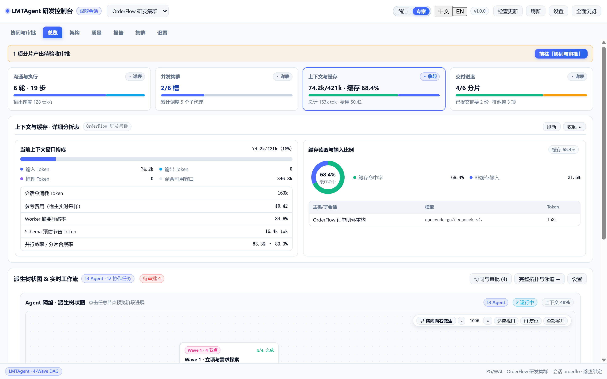
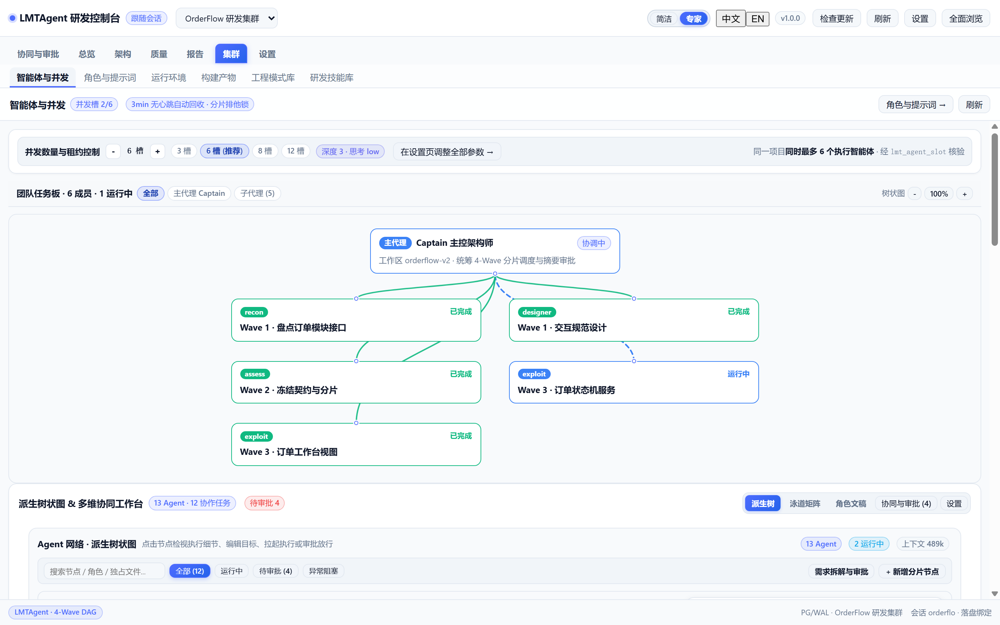
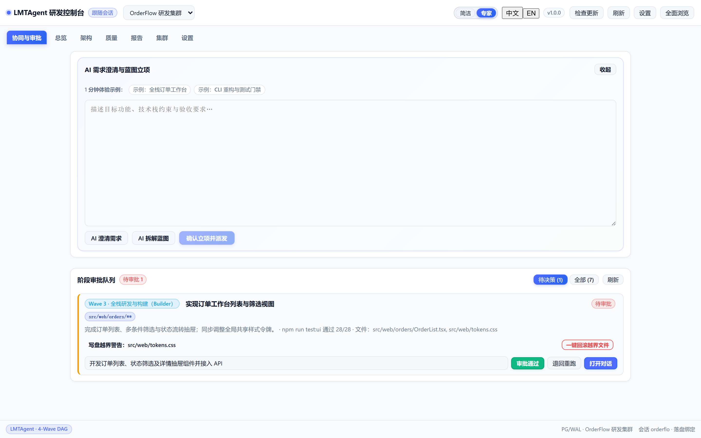
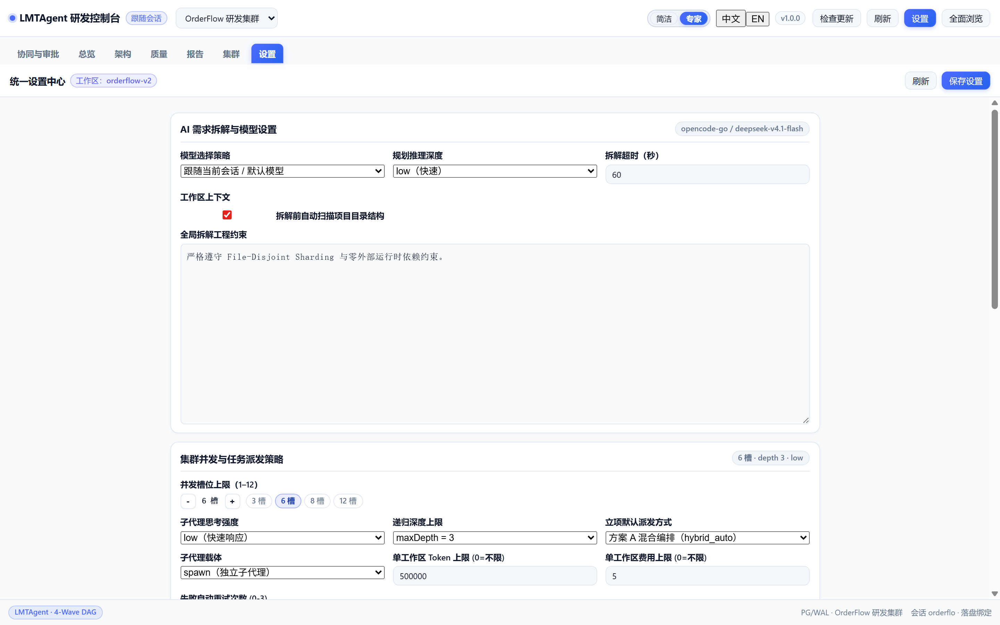

[English](README.md) | 简体中文

# LMTAgent (`v1.0.0` · `dsh-lmtagent`)

面向 DeepSeek Harness（DSH Desktop）的多智能体软件研发编排与工作台插件。

围绕 **4-Wave 受控有向无环图（4-Wave Bounded DAG）工程流水线**（「需求澄清 -> 无交集文件分片 -> 主从高并发派发 -> 摘要压缩 -> 审批与拓扑推进」），解决 AI 长程研发中的需求幻觉跑偏、多会话工作区串台、并发写盘踩踏、上下文膨胀与 Token 失控问题，并在独立命名空间（`dsh-lmtagent`）下与历史插件 `dsh-redteam-mode` 物理共存、零冲突安装。

---

## 界面预览（`v1.0.0`）

以下截图由无头 Chromium 加载真实编译产物 `packages/redteam-ui/lib/client.js` 与 `styles.js` 直接渲染采集（`zh-CN` 中文界面）：

| 总览与上下文详表（`总览`） | 集群调度与拓扑树（`集群 -> 智能体与并发`） |
| :---: | :---: |
|  |  |
| **协同审批、1 分钟体验示例与一键回滚（`协同与审批`）** | **统一设置中心与实验调度策略（`设置`）** |
|  |  |

---

## 1. `v1.0.0` 核心架构升级与特性

1. **完全独立命名空间（`dsh-lmtagent`）与无损自动迁移**
   - 采用独立 Cordis 服务与挂载命名空间（`lmtagent-mode`、`ctx.lmtagent`、`lmtagent-tools`、`lmtagent-ui`、`dsh-lmtagent-ui`、`POST /lmtagent/api`、`GET /lmtagent/events`、`preset-lmtagent*`、`$DSH_HOME/lmtagent`），可与历史插件 `dsh-redteam-mode` 同机共存，零插件 ID、槽位、路由及落盘目录冲突。
   - 首次启动若检测到旧目录 `$DSH_HOME/redteam` 且 `$DSH_HOME/lmtagent` 尚未初始化，自动执行非破坏性复制迁移（`migrateLegacyRedteamDir`），保留原有工程工作区、会话映射与设置。
2. **精简 12 项纯净工程技能包 & 12 项精简 `lmt_*` 工具集（Schema 压缩 58%）**
   - 默认发行包仅收录 **12 个纯净软件工程技能**（8 个 `eng-*` 全流程工程技能：`eng-wish-spec`、`eng-ui-design-tokens`、`eng-api-contract-sharding`、`eng-fullstack-builder`、`eng-code-review-security`、`eng-test-verification-gate`、`eng-release-changelog`、`eng-git-recovery` + `campaign-planning`、`browser-automation`、`opsec-hygiene`、`supply-chain`），其余历史渗透手册通过 `packages/redteam-bundle/tools/distribution.mjs` 的 `OMITTED_SKILLS` 移出默认包。
   - 将工具契约收敛为 **12 个高内聚 `lmt_*` 工具**（`lmt_workflow`、`lmt_agent_slot`、`lmt_engagement_open`、`lmt_session_bind`、`lmt_session_info`、`lmt_sessions`、`lmt_preflight`、`lmt_role_prompt`、`lmt_roles`、`lmt_artifact_record`、`lmt_artifact_query`、`lmt_report_export`），完整序列化 Schema 仅 **`11,645` 字节**（较旧基准 `28,000` 字节缩减 **58%**），全部 26 个 object 节点均显式声明 `additionalProperties: false`。
3. **精简高性能模块化内核（`core.js` + `ui/lib/index.js`）**
   - 存储核心 `packages/redteam-store/lib/core.js` 精简至 **`6,415` 行**，拆出 `shard-policy.js`、`session-bindings.js`、`dag-workflow.js`、`settings.js`、`pg-engine.js`、`prompts.js` 等纯模块化文件，并在读路径内置**写版本号驱动的内存缓存（`_bumpWriteSeq` + SQLite `SELECT total_changes()` + `workflow-dag.json` `mtimeMs` 校验）**。
   - 控制台宿主 `packages/redteam-ui/lib/index.js` 由 `7,504` 行拆分为 **`3,538` 行**，拆出 `scope-rollback.js`、`dag-scheduler.js`、`settings-bridge.js`、`update-manager.js`、`telemetry-jsonl.js`、`dsh-dispatch.js` 与 `llm-planner.js`。
4. **写前 `ShardLock` 预检 + 写后越界审计与 Git 安全一键回滚**
   - 通过 `checkFileAgainstShardLocks` 与 `lmt_workflow({ action: "check_scope" })` 拦截越界写盘计划；提交摘要后由 `auditWorkerScopeViolation` 检测越界文件并在审批卡片给出告警。
   - 新增 `packages/redteam-ui/lib/scope-rollback.js`（`rollbackScopeViolations`），底层严格使用 `execFileSync('git', ...)`，拒绝路径穿越与仓库外符号链接逃逸，并可在审批卡片中点击「一键回滚越界文件」即时恢复受污染文件。
5. **工作区预算熔断器、自动重试与实验性推测 DAG 流水线调度**
   - **预算熔断器（`evaluateWorkspaceBudgetGuard`）**：支持按工作区配置 `maxTokensPerWorkspace` 与 `maxCostPerWorkspace` 上限，在总览页预警并在超限时自动暂停派发（支持单次显式覆盖）。
   - **指数退避自动重试（`maxAutoRetries` `0–3`）**：Worker 瞬态失败时自动退避重试，并把前序失败摘要注入后续 Worker 任务上下文。
   - **实验性推测 DAG 流水线（`speculativeWaveDispatch` + `depends_on` + `detectDagCycles`）**：当下游节点的显式 `depends_on` 依赖已完成且排他分片锁无冲突时，无需死等整波栅栏即可提前并行派发。
6. **原生双语控制台（`中文 / EN`）与 1 分钟体验示例**
   - 新增响应式多语言状态模块 `00b-i18n.js`（`lmt_ui_locale`，支持顶部 `中文 / EN` 药丸即时切换与设置页持久化），全页签纯英文/纯中文零混杂。
   - `WishRefinerWizard` 顶部内置 2 个「1 分钟体验示例」快捷芯片（`OrderFlow-Demo`、`CliRefactor-Demo`），总览详表新增 `perfMetrics` 实时效率指标（摘要压缩率、Schema 节省 Token、并行效率与分片合规率）。

---

## 2. 4-Wave 闭环工程调度流程

```text
[用户输入需求 / 点击「1 分钟体验示例」]
      │
      ▼  步骤 1：AI 需求澄清与无交集分片 (clarifyWishWithAI / decomposeWishWithAI)
[输出结构化 refined_prompt + 4-Wave 无交集 files_owned 分片与 depends_on DAG]
      │
      ▼  步骤 2：预算熔断门禁与主从并发派发 (BudgetGuard + ShardLock + startActivation)
[Wave 1..4 并发子代理执行（支持整波栅栏或实验性 speculativeWaveDispatch 流水线）]
      │
      ▼  步骤 3：摘要压缩写回与越界审计 (submit_digest + auditWorkerScopeViolation)
[压缩 what_was_done / files_touched / verification 写入 worker_digests，支持一键 Git 回滚]
      │
      ▼  步骤 4：协同审批、下游推进与报告归档 (planApproveWorker / lmt_report_export)
[人工或主控审批通过 -> 自动派发下一就绪分片 -> 生成可复现研发交付报告]
```

---

## 3. 8 个角色预设（`maxDepth: 3`，默认 `thinking: low`）

| 序号 | 角色 ID | 预设 ID | 核心职责与输出契约 |
| :---: | :--- | :--- | :--- |
| 0 | `plan` | `lmtagent`（`LMTAgent 研发集群`） | 主控总指挥：统筹需求拆解、4-Wave DAG 调度与压缩摘要审批 |
| 1 | `recon` | `lmtagent-worker-recon` | CEO / 产品与需求规划：盘点需求边界与仓库模块拓扑，标注 P0/P1 线索 |
| 2 | `designer` | `lmtagent-worker-designer` | Designer / 交互与视觉设计：制定设计令牌、组件树与四态交互规范 |
| 3 | `assess` | `lmtagent-worker-assess` | Eng Manager / 架构与排期：冻结接口契约，划分并锁定无交集 `shard_locks` 分片 |
| 4 | `vuln-scan` | `lmtagent-worker-vuln-scan` | Reviewer & CSO / 审查与安全：静态代码审查、并发竞态与安全红线审计 |
| 5 | `exploit` | `lmtagent-worker-exploit` | Builder / 全栈研发与构建：在独占 `files_owned` 边界内编码实现并提交摘要 |
| 6 | `qa` | `lmtagent-worker-qa` | QA Lead / 质量保障与测试：执行构建校验、敏感门禁与全量回归测试 |
| 7 | `internal` | `lmtagent-worker-internal` | Doc & Release / 文档与发布：同步文档与变更日志，汇编工程交付报告 |

---

## 4. 宿主挂载槽位、双模存储与事件流

- **6 个独立 `lmtagent-*` 宿主槽位**：`lmtagent-console`（`shell.overlay`）、`lmtagent-workbench`（`main`）、`lmtagent-panellist`（`sidebar.panellist`）、`lmtagent-view`（`conversation.view`）、`lmtagent-header-toggle`（`conversation.session.header.utilities`）、`lmtagent-settings`（`settings.section`）。
- **增量遥测与实时流**：基于 `.jsonl` 字节偏移尾读（`packages/redteam-ui/lib/telemetry-jsonl.js`）以及 `POST /lmtagent/api` 与 `GET /lmtagent/events` SSE 推送实时状态变化。
- **双模存储底座**：配置 `LMTAGENT_PG_URL`、`REDTEAM_PG_URL`、`DSH_PG_URL`、`DATABASE_URL` 或 `PGHOST` 时连接外部 PostgreSQL（Wire Protocol v3）；未配置时使用 `$DSH_HOME/lmtagent` 下的本地 SQLite WAL 数据库（零外部运行时依赖）。

---

## 5. 安装方式

### 命令行安装

```bash
dsh plugin add github:ECCVIK/LMTAgent
```

### DSH Desktop 插件市场安装

在 DSH Desktop「插件市场」中搜索 `dsh-lmtagent` / `LMTAgent`，或通过「导入插件」安装 `github:ECCVIK/LMTAgent`（GitHub Releases 同步提供预编译 `dsh-lmtagent-<version>.tgz` 发行包）。

---

## 6. 构建、门禁与全量测试

```bash
# 组装前端样式/客户端并同步至 packages/redteam-bundle 与仓库根目录
npm run build
node packages/redteam-bundle/tools/build.mjs --check
node packages/redteam-ui/tools/assemble-client.mjs --check
node packages/redteam-ui/tools/assemble-styles.mjs --check

# 敏感内容闸门自检与全仓扫描（0 命中）
node scripts/check-no-confidential.mjs --selftest
node scripts/check-no-confidential.mjs --all

# 运行全部 22 个零依赖测试套件（22 个文件 / 1,289 条断言通过）
npm test
```
