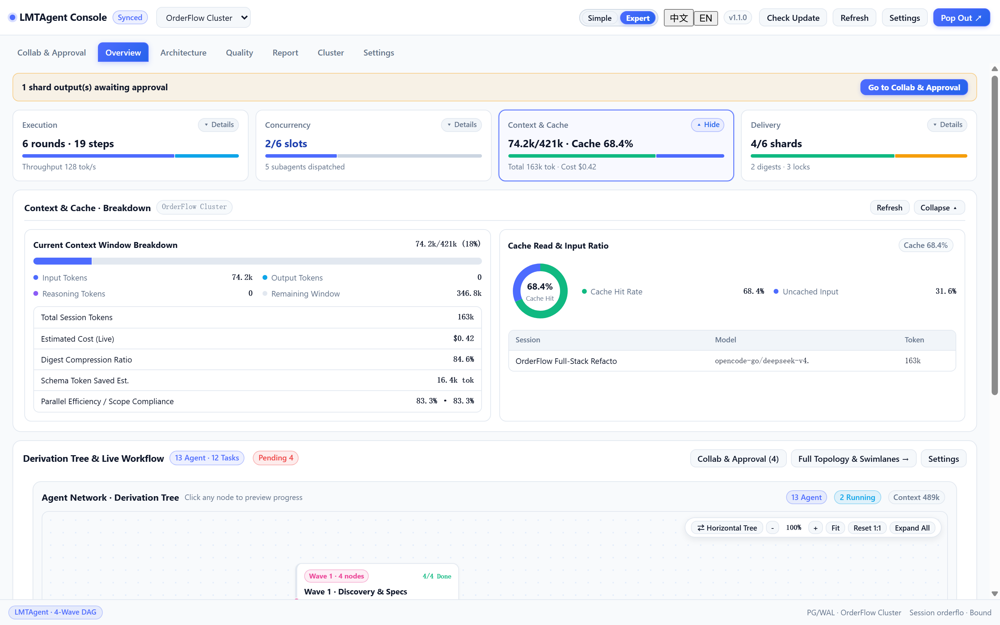
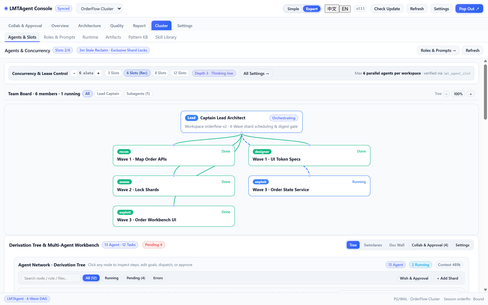
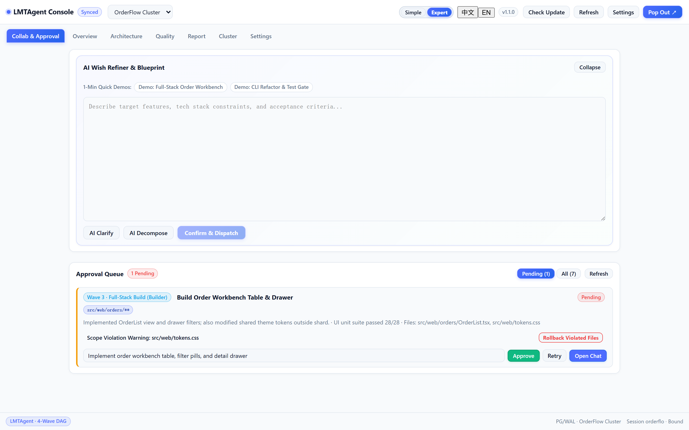
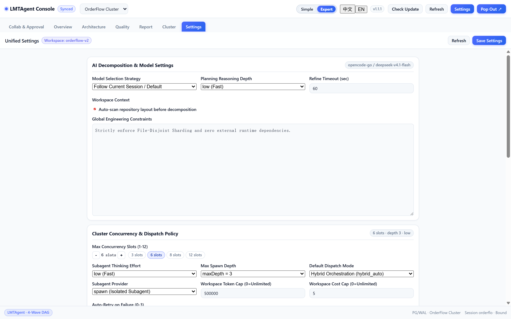

# dsh-lmtagent (`v1.1.1`)

**Multi-agent full-stack dev workbench for DeepSeek Harness (DSH Desktop)**: turns feature wishes into parallel file-disjoint coding shards with 8 role presets, a detached standalone OS window, one-click Git scope rollback, workspace budget guard, and a live bilingual DAG console.

[Full English Documentation](https://github.com/ECCVIK/LMTAgent/blob/main/README.md) | [Simplified Chinese Documentation](https://github.com/ECCVIK/LMTAgent/blob/main/README.zh-CN.md)

```bash
dsh plugin add github:ECCVIK/LMTAgent
```

---

## UI Preview (`v1.1.0`)

| Live Overview & Efficiency Metrics | Cluster Concurrency & Derivation Tree |
| :---: | :---: |
|  |  |
| **1-Min Quick Demos & Git Scope Rollback** | **Unified Settings & Budget Guard** |
|  |  |

---

## Highlights (`v1.1.0`)

- **Standalone Pop-Out Desktop Window (`Pop Out ↗`)**: Opens LMTAgent in a detached chromeless OS window (`--app=` mode) sharing the live DSH same-origin API and SSE stream — ideal for dual-monitor workflows without cramped sidebars.
- **Independent Coexistence Namespace (`dsh-lmtagent`)**: Clean Cordis IDs, `/lmtagent/api` routes, `preset-lmtagent*` presets, and `$DSH_HOME/lmtagent` storage (with automatic non-destructive copy migration from `$DSH_HOME/redteam`).
- **12 Lean `lmt_*` Tools (`11,645` Bytes Schema) & 12 Clean Engineering Skills**: 58% smaller tool schema footprint and zero legacy pentest handbooks in the default package.
- **Safety & Experimental Performance**: Pre/post-write `ShardLock` + Git `rollbackScopeViolations`, workspace Token/Cost budget circuit breaker, exponential-backoff auto-retry (`maxAutoRetries`), experimental speculative DAG pipelining (`speculativeWaveDispatch`), and reactive `en-US` / `zh-CN` UI.

---

## Verification

```bash
node packages/redteam-bundle/tools/build.mjs --check
node scripts/check-no-confidential.mjs --selftest
node scripts/check-no-confidential.mjs --all
npm test
```
