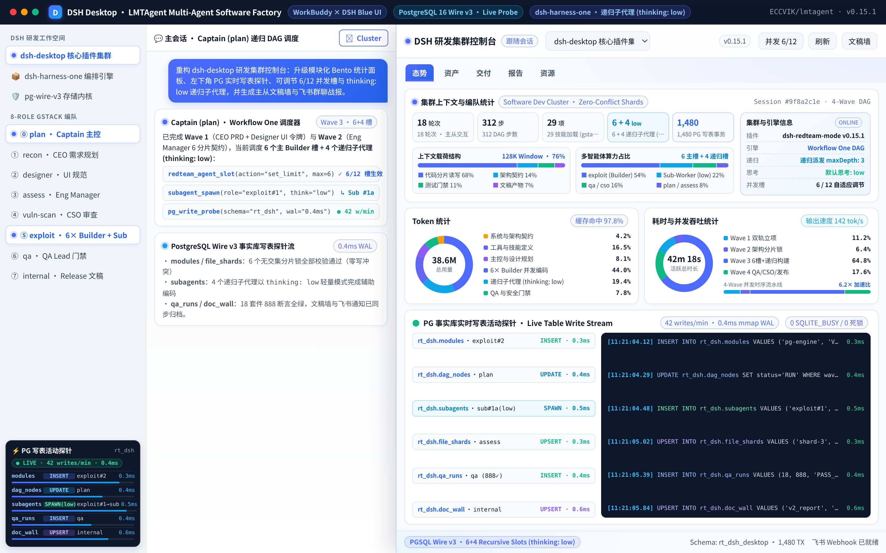
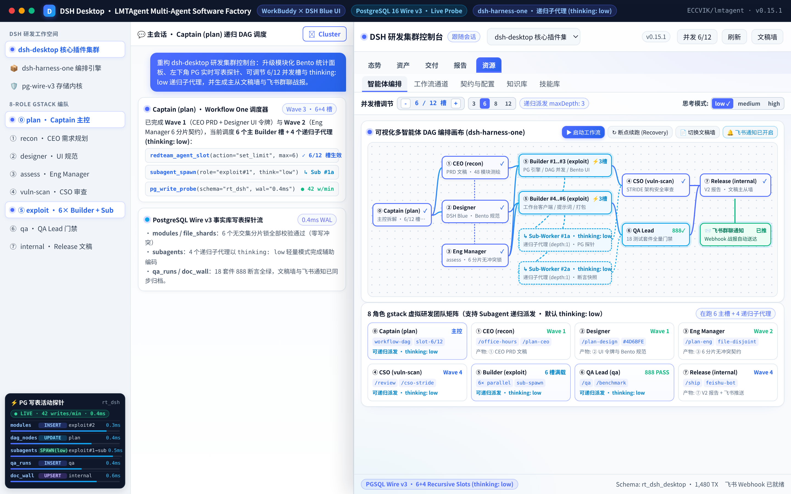
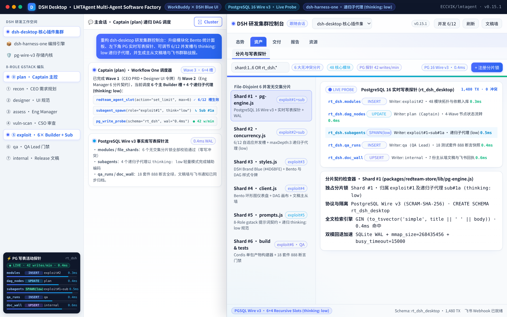
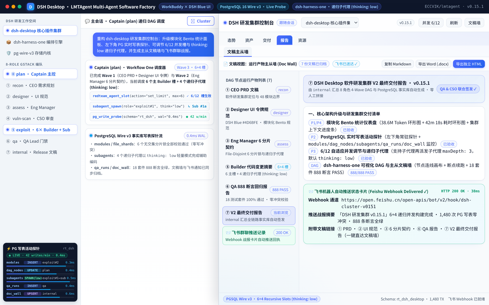

# ⚡ LMTAgent (`dsh-redteam-mode` v0.15.1)

**为 [DeepSeek Harness (DSH Desktop)](https://github.com/anywhere-labs/dsh-desktop) 打造的「WorkBuddy × DSH Brand Blue」8 角色全栈软件研发集群与可视化多智能体编排工作台**

  <b>主代理（Captain）意图拆解 · 7 位 <code>gstack</code> 专家子代理协同 · 支持子代理递归派发微任务（<code>maxDepth: 3</code>，默认 <code>thinking: low</code>） · <code>1–12</code> 并发槽在线调节（默认 6） · 模块化 Bento 遥测仪表盘 + <code>dsh-harness-one</code> 可视化 DAG 画布 / 文稿主从墙 / 飞书群聊推送 + PG 实时写表活动探针</b>

---

## ✨ 1. 模块化 Bento 仪表盘与 `dsh-harness-one` 可视化工作流画布展示（UI Gallery）

| **① 模块化 Bento 遥测仪表盘与 PG 实时写表探针（`p1` + `p2` + `p4`）** | **② 可视化多智能体 DAG 编排画布与并发槽在线调节（`p3` + `dsh-harness-one`）** |
| :---: | :---: |
|  |  |
| *5 大集群指标砖块、上下文载荷与算力分布条、Token/耗时双 SVG 环形图、左下角与底部实时 PG 写表探针* | *顶栏 `6/12` 并发槽步进/快捷胶囊、子代理递归派发 (`maxDepth: 3`, `thinking: low`)、可视化 DAG 节点连线画布（含断点续跑）与 2×4 角色矩阵* |
| **③ PostgreSQL 16 实时写表活动探针与无冲突文件分片（PG Live Probe）** | **④ `dsh-harness-one` 文稿主从墙与飞书群聊战报推送（Doc Wall & Feishu）** |
|  |  |
| *6 个 File-Disjoint 无冲突分片锁检查器 + PostgreSQL 16 实时表级写入监控 (`modules` / `dag_nodes` / `subagents`)* | *左侧按拓扑顺序列出 DAG 节点产物条带，右侧大卡预览 V2 交付文稿与飞书 Webhook 自动推送回执* |

---

## 🧠 2. 8 角色 `gstack` 虚拟研发团队 + 子代理递归派发（`maxDepth: 3`，默认 `thinking: low`）

- **主代理拆解 + 子代理递归派发（`maxDepth: 3`）**：除主代理（Captain `plan`）外，7 类专家子代理（`recon` CEO、`designer` Designer、`assess` Eng Manager、`vuln-scan` Reviewer/CSO、`exploit` Builder、`qa` QA Lead、`internal` Doc & Release）均挂载 `@deepseek-ai/dsh-tool-subagent`，可递归派发轻量级 `Sub-Worker` 解决局部小问题。
- **默认低思考开销（`thinking: low`）**：子代理默认以 `thinking: low` 高效执行，支持在控制台顶栏实时调节并发槽（`1–12`）、递归深度（`1–5`）与思考强度（`low / medium / high`）。
